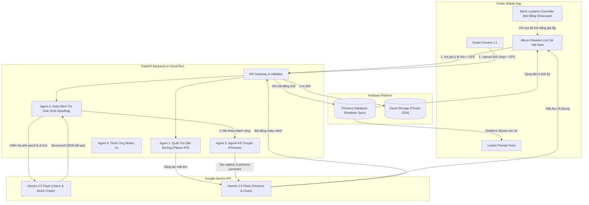

# KIẾN TRÚC HỆ THỐNG LOCKULTURE (TIME TRAVELER’S LOCKET)
### NỀN TẢNG KHÁM PHÁ LỊCH SỬ VIỆT NAM — ĐỊA BÀN THÍ ĐIỂM SHOWCASE: THÀNH PHỐ ĐÀ NẴNG

- **Mã dự án:** LOCKULTURE-GDG2026.
- **Phiên bản:** 2.2 — ngày 09/11/2026.
- **Tài liệu nghiệp vụ:** [PROJECT_SPECIFICATION.md](PROJECT_SPECIFICATION.md).
- **Hợp đồng API:** [API_SPECIFICATION.md](API_SPECIFICATION.md).
- **Đặc tả Giao diện UI:** [UI_SPECIFICATION.md](UI_SPECIFICATION.md).

---

## 1. PHÂN CHIA THÀNH PHẦN HỆ THỐNG (HYBRID ARCHITECTURE)

Hệ thống Lockulture áp dụng mô hình kết hợp (Hybrid) giữa **FastAPI trên Google Cloud Run** (chuyên trách các tác vụ nặng về AI Multi-Agent) và **Firebase** (chuyên trách dữ liệu thời gian thực và lưu trữ hình ảnh). Nền tảng tổ chức theo kiến trúc mở hỗ trợ các di tích trên toàn quốc, trong đó Đà Nẵng là bộ dữ liệu hoàn thiện cao nhất để demo trong kỳ thi Hackathon.

| Thành phần | Nền tảng / Công nghệ | Vai trò & Trách nhiệm |
| :--- | :--- | :--- |
| **Mobile Client** (`mobile/`) | Flutter / Dart | • Giao diện Album Pokedex Lịch Sử Việt Nam (với dữ liệu Đà Nẵng).<br>• Live Camera 1:1, kiểm soát anti-spoofing.<br>• Realtime Feed Stream từ Firebase Firestore.<br>• Bảng điều khiển Mock Location Đà Nẵng. |
| **BaaS Realtime** | Firebase Firestore & Cloud Storage | • Lưu trữ metadata người dùng, nhóm bạn (Locket Circles).<br>• Lắng nghe stream bài đăng thời gian thực (`onSnapshot()`).<br>• Lưu trữ ảnh chụp chứng tích di tích với CDN tốc độ cao. |
| **AI Gateway & Orchestrator** (`backend/`) | Python 3.11 + FastAPI on Google Cloud Run | • Điều phối 4 AI Agents cốt lõi.<br>• Tích hợp Function Calling Google Places API.<br>• Gọi Gemini 2.5 Flash Vision & Text với Pydantic schema.<br>• Xử lý kiểm định ảnh 3 lớp (Anti-spoofing). |
| **Hệ thống Multi-Agent** | Google Gemini API (Gemini 2.5 Flash) | • **Agent 1:** Quét Places, sáng tác mật thư lịch sử (ưu tiên Cầu Rồng/Thành Điện Hải Đà Nẵng).<br>• **Agent 2:** Kiểm tra vân màn hình, nhận diện di tích, xuất Structured JSON.<br>• **Agent 3:** Sinh caption Gen Z, persona roleplay nhân vật lịch sử.<br>• **Agent 4:** Thích ứng nhiệm vụ địa lý & Co-op Quest đa thành phố. |

---

## 2. SƠ ĐỒ LUỒNG DỮ LIỆU TỔNG THỂ (MERMAID ARCHITECTURE)



---

## 3. THIẾT KẾ CHI TIẾT 4 AI AGENTS CHO ĐỊA BÀN ĐÀ NẴNG

### 3.1. Agent 1: "Quản Trò Dẫn Đường" (Dynamic Clue Agent)
* **Khu vực áp dụng:** Thành phố Đà Nẵng (bán kính quét di tích $1\text{ km} - 5\text{ km}$).
* **Prompt Persona:**
  ```text
  Ngươi là 'Người Gác Cổng Thời Gian Đà Nẵng'. Hãy dựa vào thông tin địa danh {landmark_name} thuộc thời kỳ {era_name} và tạo một câu đố mật thư cổ phong ngắn gọn dưới 50 từ.
  Yêu cầu: Không được nói trực tiếp tên địa điểm. Sử dụng các đặc điểm nổi bật (ví dụ: Cầu Rồng phun lửa, mái ngói Thành Điện Hải, tượng Chăm Pa bằng sa thạch).
  ```

### 3.2. Agent 2: "Giám Định Viên Lịch Sử" (Multimodal Anti-Spoofing Agent)
* **Quy trình 3 bước kiểm tra:**
  1. *Lớp 1 (Camera check):* Chỉ chấp nhận ảnh phát sinh từ luồng camera trực tiếp của ứng dụng (không có Exif camera metadata của phần mềm chỉnh sửa).
  2. *Lớp 2 (Geofence distance):* Tính khoảng cách Haversine giữa GPS của người dùng với tọa độ di tích Đà Nẵng trong cơ sở dữ liệu. Nếu khoảng cách $> 500\text{ m}$ (và không bật Mock Mode) ➔ từ chối.
  3. *Lớp 3 (Gemini 2.5 Flash Vision Moiré Detection):*
     ```python
     class VerificationOutput(BaseModel):
         is_valid: bool
         confidence_score: float
         detected_landmark: str
         matched_era: str
         is_screen_spoof: bool = Field(
             description="True nếu phát hiện vân lưới Moiré, viền bezel của màn hình laptop/điện thoại hoặc ánh sáng phản chiếu từ màn hình thiết bị khác."
         )
         reject_reason: Optional[str]
         xp_reward: int
     ```

### 3.3. Agent 3: "Người Kể Chuyện Locket" (Dual-Mode Storyteller Agent)
* **Cơ chế hoạt động:**
  - Nhận tên di tích đã mở khóa.
  - Tự động gán nhân vật Persona tương ứng (Thần Rồng Vàng Sông Hàn cho Cầu Rồng, Danh tướng Nguyễn Tri Phương cho Thành Điện Hải...).
  - Xuất bản bản nháp lên Mobile Client:
    - Nếu người dùng bấm `[ Đăng tức thì ]` ➔ gửi trực tiếp lên Firebase Firestore.
    - Nếu người dùng bấm `[ Tùy chỉnh ]` ➔ cho phép gõ thêm cảm nghĩ của bản thân trước khi đăng.

### 3.4. Agent 4: "Kiến Trúc Sư Nhiệm Vụ" (Adaptive Gamification)
* **Hỗ trợ thích ứng:** Nếu phát hiện người dùng ở xa trung tâm Đà Nẵng (ví dụ ở Hòa Vang hoặc ngoại thành), tự động đổi đề bài sang: *"Chụp chiếc cầu gần bạn nhất bắc qua sông"* hoặc *"Chụp họa tiết hoa văn truyền thống trên đồ gốm/sách báo"*.

---

## 4. CHIẾN LƯỢC TRIỂN KHAI VÀ BẢO ĐẢM HIỆU NĂNG

1. **Độ trễ xử lý (Latency SLA):**
   - Nén ảnh phía Flutter trước khi truyền (tối đa $1080 \times 1080$, dung lượng $< 600\text{ KB}$).
   - Gemini 2.5 Flash xử lý nhận diện ảnh trong vòng **$1.8 - 2.5\text{ giây}$**.
   - Firebase Firestore cập nhật realtime bài đăng tới các máy bạn bè trong vòng **$< 500\text{ ms}$**.
2. **Kế hoạch phòng thủ rớt mạng (Fail-Safe Demo):**
   - Toàn bộ danh mục 12 di tích Đà Nẵng kèm ảnh mẫu và tọa độ chuẩn được lưu sẵn trong bộ nhớ đệm (Cache) của Backend và Mobile app. Nếu mất kết nối với Google Places API, Agent 1 tự động lấy mật thư từ cache để không bao giờ bị đơ khi chấm thi.
