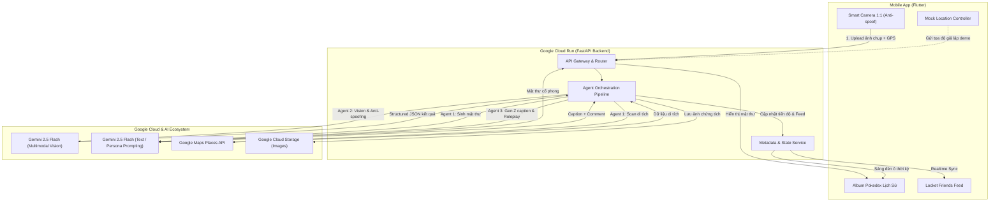

# KIẾN TRÚC HỆ THỐNG TIME TRAVELER’S LOCKET (CHRONOLOCKET)

- **Dự án:** CHRONO-LOCKET-GDG2026.
- **Phiên bản:** 2.0 — ngày 05/11/2026.
- **Tài liệu nghiệp vụ:** [PROJECT_SPECIFICATION.md](PROJECT_SPECIFICATION.md).
- **Hợp đồng API:** [API_SPECIFICATION.md](API_SPECIFICATION.md).
- **Phạm vi:** Tài liệu mô tả kiến trúc mục tiêu kết hợp ứng dụng di động (Mobile App - Flutter), Backend Gateway (FastAPI trên Google Cloud Run) và Hệ sinh thái Đa tác tử (Multi-Agent System) tích hợp Google Gemini API.

---

## 1. HIỆN TRẠNG & PHÂN CHIA THÀNH PHẦN HỆ THỐNG

| Thành phần | Công nghệ / Nền tảng | Trách nhiệm chính |
| :--- | :--- | :--- |
| **Mobile Client** (`mobile/`) | Flutter / Dart (Clean Architecture) | • Giao diện Album Pokedex dòng thời gian phi tuyến tính.<br>• Live Camera tỉ lệ 1:1 chuẩn Locket, chặn upload thư viện.<br>• Bảng điều khiển Mock Location phục vụ demo sân khấu.<br>• Social Feed riêng tư cho nhóm bạn thân, thả reaction/comment. |
| **Backend API Gateway** (`backend/`) | Python 3.11 + FastAPI + Docker | • Xác thực người dùng & quản lý vòng kết nối bạn bè (Locket Circle).<br>• Tiếp nhận ảnh nén, tọa độ GPS, điều phối luồng gọi Multi-Agent.<br>• Lưu trữ metadata tiến độ Album và Feed bài đăng. |
| **Agent 1: Quản Trò Dẫn Đường** | Gemini API + Function Calling (Google Places API) | • Quét di tích bán kính 1km - 5km theo tọa độ GPS.<br>• Sáng tác câu đố/mật thư ẩn dụ phong cách cổ xưa.<br>• Tự động hạ độ khó khi người dùng xin thêm gợi ý. |
| **Agent 2: Giám Định Thị Giác** | Gemini Multimodal Vision + Structured JSON | • Kiểm tra Anti-spoofing (chống chụp màn hình/sách báo).<br>• Nhận diện công trình/hiện vật, đối chiếu thời kỳ lịch sử.<br>• Xuất JSON chuẩn hóa: `{ is_valid, detected_landmark, xp_reward }`. |
| **Agent 3: Người Kể Chuyện** | Gemini 2.5 Flash Persona Roleplay | • Tạo Gen Z Caption ngắn gọn kèm Fun Fact lịch sử.<br>• Đóng vai nhân vật lịch sử để lại bình luận đầu tiên dưới ảnh. |
| **Agent 4: Thích Ứng Nhiệm Vụ** | Rule-based Engine + Gemini Fallback | • Phân tích mật độ di tích địa phương của người dùng.<br>• Chuyển đổi nhiệm vụ sang hiện vật bảo tàng hoặc Co-op Quest. |
| **Hạ tầng Cloud** | Google Cloud Run + Cloud Storage | • Container hóa Backend chạy serverless tự động co giãn.<br>• Lưu trữ hình ảnh chứng tích với URL có chữ ký (Signed URL). |

---

## 2. NGUYÊN TẮC KIẾN TRÚC MỤC TIÊU

1. **Không gian dẫn lối – Thời gian ghi nhận (Location-First, Timeline-Organized):** Người dùng khám phá di tích phi tuyến tính theo không gian thực tế; hệ thống tự động gắn mảnh ghép mở khóa vào đúng ô thời kỳ trên Album Pokedex.
2. **Stateless Backend trên Google Cloud Run:** Toàn bộ API và điều phối Multi-Agent không lưu phiên cục bộ trên RAM container, giúp tự động co giãn không giới hạn và chịu tải cao trong kỳ thi Hackathon.
3. **Tối ưu hóa độ trễ (Latency Target < 3.5s):** 
   - Mobile Client nén ảnh trước khi truyền tải ($1080 \times 1080$, dung lượng $< 800\text{ KB}$).
   - Sử dụng mô hình `gemini-2.5-flash` hoặc `gemini-1.5-flash` cho các tác vụ Vision và Text generation.
   - Sử dụng định dạng `response_mime_type: "application/json"` với Pydantic / JSON Schema để tránh việc parse text tự do gây lỗi hoặc tăng thời gian trễ.
4. **Phòng vệ gian lận nhiều tầng (Defense in Depth):**
   - Tầng 1 (Mobile Client): Chỉ cho phép chụp live camera, chặn nút chọn file từ thư viện ảnh máy.
   - Tầng 2 (Metadata): Đính kèm GPS và thời gian chụp thực tế từ cảm biến thiết bị.
   - Tầng 3 (Agent 2 Vision): Kiểm tra vân lưới Moiré, viền bezel màn hình và độ tương phản phản quang.
5. **Độc lập và khả năng Demo cao (Resilience & Demo Mode):** Cung cấp công tắc `Mock Location` ở cả Client và Backend để đảm bảo việc demo trên sân khấu hội trường không bị ảnh hưởng bởi tín hiệu GPS yếu hay rớt mạng ngoài ý muốn.

---

## 3. SƠ ĐỒ TỔNG THỂ KIẾN TRÚC HỆ THỐNG



---

## 4. THIẾT KẾ MULTI-AGENT BACKEND

### 4.1. Agent 1: "Quản Trò Dẫn Đường" (Dynamic Clue & Location Agent)
* **Mục tiêu:** Cung cấp mật thư câu đố dẫn đường mà không làm lộ tên địa điểm trực tiếp.
* **Quy trình xử lý:**
  1. Nhận `(lat, lng, era_id, hint_level)` từ Client.
  2. Gọi `Google Maps Places API (Nearby Search)` với các `includedTypes`: `tourist_attraction`, `museum`, `historical_landmark`, `place_of_worship`.
  3. Lọc địa điểm phù hợp nhất với `era_id`.
  4. Gửi thông tin (tên, khoảng cách, đặc điểm kiến trúc) vào prompt Gemini với Persona: *"Ngươi là Người Gác Cổng Thời Gian. Hãy tạo một mật thư dài dưới 50 từ dẫn đường người lữ khách tới địa điểm này..."*.
  5. Nếu `hint_level > 1`, hạ độ khó bằng cách tiết lộ hướng đi cụ thể hoặc chữ cái đầu.

### 4.2. Agent 2: "Giám Định Viên Lịch Sử" (Multimodal Verification Agent)
* **Mục tiêu:** Kiểm tra tính xác thực của ảnh và quyết định mở khóa.
* **Quy trình xử lý:**
  1. Nhận file ảnh JPEG ($1080 \times 1080$), tọa độ GPS, mã thời kỳ `era_id`.
  2. Truyền ảnh vào `gemini-2.5-flash` kèm `response_schema` theo Pydantic:
     ```python
     class VerificationResponse(BaseModel):
         is_valid: bool
         confidence_score: float
         detected_landmark: str
         matched_era: str
         is_screen_spoof: bool
         reject_reason: Optional[str]
         xp_reward: int
     ```
  3. Kiểm tra:
     - Nếu `is_screen_spoof == True` ➔ Từ chối ngay: *"Ảnh chụp màn hình, hãy chụp ngoài thực địa"*.
     - Nếu `matched_era != era_id` ➔ Từ chối: *"Công trình thuộc thời kỳ khác, hãy kiểm tra lại"*.
     - Nếu hợp lệ ➔ Cập nhật Album thành công.

### 4.3. Agent 3: "Người Kể Chuyện Locket" (Social Storytelling Agent)
* **Mục tiêu:** Lan tỏa giá trị giáo dục - văn hóa lên mạng xã hội của nhóm bạn.
* **Quy trình xử lý:**
  1. Nhận thông tin di tích đã mở khóa từ Agent 2.
  2. Tạo Caption: Phong cách Gen Z hài hước lồng ghép Fun fact lịch sử ngắn gọn.
  3. Tạo Comment: Chọn persona nhân vật lịch sử thời kỳ đó để để lại bình luận đầu tiên dưới bài đăng.

### 4.4. Agent 4: "Kiến Trúc Sư Nhiệm Vụ" (Adaptive Gamification Agent)
* **Mục tiêu:** Đảm bảo tính khả thi ở mọi vùng địa lý.
* **Quy trình xử lý:**
  1. Nếu Agent 1 không tìm thấy di tích phù hợp trong bán kính $10\text{ km}$:
  2. Agent 4 chuyển đổi nhiệm vụ: Cho phép chụp hiện vật bảo tàng hoặc hoa văn truyền thống tương đương.
  3. Hoặc kích hoạt cờ `coop_eligible = True` cho phép bạn bè ở tỉnh/thành khác mở khóa hộ.

---

## 5. THIẾT KẾ ỨNG DỤNG MOBILE (FLUTTER CLIENT)

Ứng dụng Flutter được tổ chức theo kiến trúc **Feature-First Clean Architecture**:

```text
mobile/lib/
├── core/
│   ├── constants/       # API endpoints, Era definitions, theme colors
│   ├── network/         # Dio HTTP client, Interceptors, Token management
│   ├── services/        # LocationService, MockLocationService
│   └── utils/           # Image compressor, date formatters
├── features/
│   ├── auth/            # Login, Circle selection, Guest mode
│   ├── album/           # Pokedex Album Grid, Era Card Widget, Progress Bar
│   ├── clues/           # Clue Bottom Sheet Modal, Hint levels
│   ├── camera/          # CameraPreview 1:1, Scanner Animation, Upload State
│   └── feed/            # Locket Friends Feed, Reaction Buttons, Persona Comments
└── main.dart            # App entrypoint, Dependency Injection, Router
```

### Quản lý trạng thái (State Management):
- Sử dụng **Riverpod** hoặc **Bloc/Cubit** đảm bảo luồng dữ liệu một chiều rõ ràng, tách biệt hoàn toàn Logic nghiệp vụ khỏi UI widget.
- Sử dụng **Dio** tích hợp tự động nén ảnh `flutter_image_compress` trước khi gửi lên Backend.

---

## 6. HỢP ĐỒNG TRIỂN KHAI DOCKER & GOOGLE CLOUD RUN

Dự án đóng gói Backend vào một Docker image tiêu chuẩn:

```dockerfile
# backend/Dockerfile
FROM python:3.11-slim
WORKDIR /app
COPY requirements.txt .
RUN pip install --no-cache-dir -r requirements.txt
COPY . .
ENV PORT=8080
CMD ["python", "-m", "uvicorn", "src.main:app", "--host", "0.0.0.0", "--port", "8080"]
```

Lệnh triển khai trực tiếp lên Google Cloud Run:
```bash
gcloud run deploy chronolocket-api \
    --source ./backend \
    --platform managed \
    --region asia-southeast1 \
    --allow-unauthenticated \
    --set-env-vars GEMINI_API_KEY=xxx,MAPS_API_KEY=yyy
```
