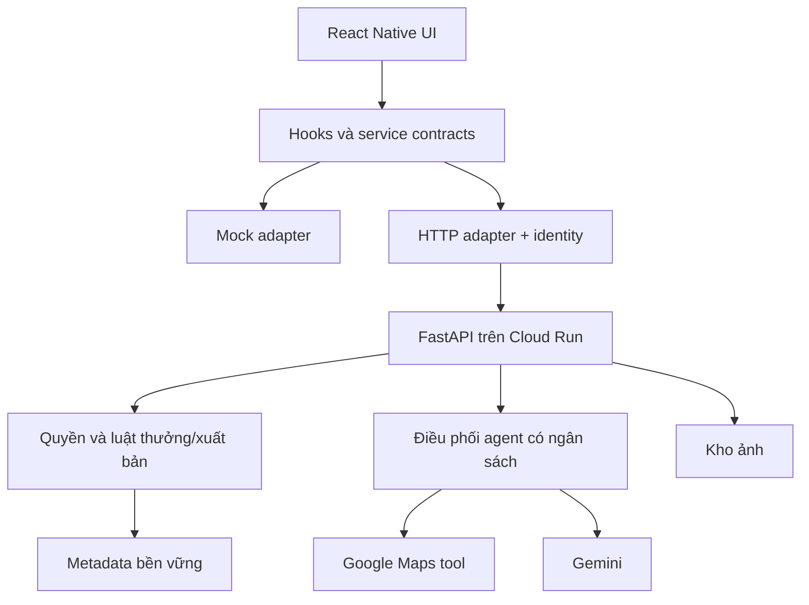

# Kiến trúc hiện tại và mục tiêu

Cập nhật 11/11/2026 · [Chỉ mục](README.md).

## Hiện tại

React Native/Expo Router → feature screens → một phần service mock, một phần Zustand trực tiếp → AsyncStorage/file local. TanStack Query và HTTP helper đã có nhưng chưa áp dụng đồng nhất. API adapter chưa triển khai; đổi env không chuyển tất cả store thành backend.

FastAPI đã nhận verification gọi Gemini thật từ main; các module khác còn mẫu. Chưa có DB nghiệp vụ, auth hay Maps tool. Policy verification hiện chưa khớp luồng React Native; xem [ghi chú merge](integration/UPSTREAM_MERGE.md). Xem [API hiện hành](api/CURRENT.md) và [inventory code](CURRENT_STATE.md).

## Mục tiêu tích hợp (chưa triển khai)

Provider auth/DB/storage chưa chốt. Không coi RAM hoặc filesystem container là kho bền vững. Secrets chỉ ở backend; EXPO_PUBLIC là cấu hình công khai.

## Bốn vai trò logic backend

| Vai trò | Trách nhiệm mục tiêu |
|---|---|
| Quản trò | Truy vấn Maps, chọn ứng viên, mật thư, gợi ý và tiêu chí |
| Giám định viên | Đánh giá ảnh theo mode và ngữ cảnh bổ sung |
| Kiến trúc sư nhiệm vụ | Điều chỉnh chiến lược trong mục tiêu/ngân sách, dừng khi không phù hợp |
| Người kể chuyện | Kiến thức ngắn, caption tùy chọn, có thể gộp với đánh giá |

Không bắt buộc bốn container hoặc bốn request nối tiếp. Code server chịu trách nhiệm quyền, giới hạn, idempotency và thưởng; AI không tự đăng feed hoặc quyết định quyền truy cập.

## Hai vòng agentic mục tiêu

1. Mục tiêu era/vị trí → chọn query → Maps → đánh giá ứng viên → đổi query trong budget hoặc phát hành mission → lưu tiêu chí/hints. Không tự đổi era/radius; Place ID phải đến từ tool.
2. Ảnh + mission/free context → đánh giá → yêu cầu chi tiết nếu thiếu → bổ sung ảnh cùng session → kết quả. Lỗi dịch vụ tách verdict; thành công lưu discovery và cấp thưởng một lần.

Frontend chỉ thu thập dữ liệu, hiển thị trạng thái, cho người dùng quyết định bước tiếp. Caption và xuất bản là hai việc riêng.

## Ranh giới dữ liệu

- Server là nguồn chuẩn cho identity, mission/version, discovery, XP, membership, audience và quyền đọc ảnh/bài.
- Frontend giữ draft, lựa chọn UI, cache đã phân vùng account. Mock store không phải kiểm soát bảo mật.
- DB cần transaction cho thưởng/tiến trình, publication/audience, acceptance/friendship.
- AI lâu nên có job/session bền vững và polling; kiến trúc triển khai cụ thể là đề xuất trong [integration](integration/PLAN.md).
